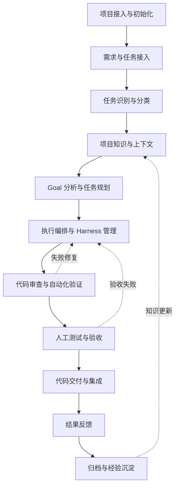

# 01 — 端到端项目流程

## 1. 流程总览

## 2. 阶段定义

### 01 项目接入与初始化

- 用户先在本地机器准备项目目录和 Git 仓库。
- 中台导入项目路径和远程仓库身份。
- Agent 扫描仓库入口文档、技术栈、依赖、启动和测试命令。
- 识别项目声明的密钥需求。
- 配置 Local Mock / Integrated 环境并进行启动验证。
- 生产凭据不参与普通初始化。

交付物：Project Profile、Repository Mapping、Environment Inventory、Secret Requirement Inventory、初始化报告。

Owner 在工作台选择“项目接入”，登记控制面机器上的 Git 仓库，随后运行 HEAD 检查。任务详情展示实际执行的 Worker、Worktree、提交号、退出码和事件。已有项目会列出最近一次 HEAD 检查。仓库尚无提交时可先检查失败回执，补上初始提交后在项目页重新检查。项目环境的启动验证和初始化报告分别验收。

成功的 HEAD 检查可在任务详情“读取仓库清单”。控制面按回执中的提交遍历已跟踪的普通文件，为入口文档、包清单、锁文件、构建与启动配置、ForgeOS 配置保存路径和 Git blob。Go 模块列出声明的依赖模块名；Node.js 包列出依赖包名及可调用的 npm 脚本名。其他已识别的依赖清单先提供文件引用。打开历史清单可核对扫描时的 GitHub origin 和控制面绑定的仓库数字 ID。仓库更新后在项目接入页选择“检查当前 HEAD”，从新任务生成新版本的清单。

Owner 用 `POST /tasks/{id}/repository-inventory` 生成或复用清单，`GET` 读取归档。首次扫描需要本机克隆仍有对应提交，归档随项目数据库保存。无效或过大的清单会在对应条目标明原因。整棵树的 Git 列表上限为 16 MiB，最多归档 2000 个匹配文件；解析单个包清单最多读取 256 KiB，每次累计 8 MiB。符号链接、子模块、vendor 和 node_modules 目录不作为初始化输入。依赖声明与脚本名称仅作发现依据，启动及测试结果另有实际执行回执。

### 02 需求与任务接入

- GitHub Issue 是第一版主要远程入口。
- 中台 Web 是辅助入口。
- Agent 任务模板自动进入待调度流程。
- 普通讨论模板只进入讨论收件箱，不启动 Agent。
- 允许普通讨论后续转换为 Agent 任务。
- 本地 Poller 为主要同步方式，Webhook 可作为补充。
- 事件去重、需求版本、角色权限必须具备。

### 03 任务识别与分类

主要类型：
- Development；
- Code Review；
- Testing；
- Investigation；
- Operations。

分类规则优先，必要时调用分类 Agent。意图不清楚时进入澄清，不擅自扩大任务范围。

### 04 项目知识与上下文

- Agent 自主读取仓库文档和代码。
- 中台提供项目结构化信息 API 和知识检索 API。
- 不把整个仓库预先塞入模型上下文。
- 按 Agent 角色提供不同的启动提示词和工具权限。
- 检索结果必须包含来源、状态和适用范围。

### 05 Goal 分析与任务规划

- 简单任务直接 Work Item。
- 复杂任务使用 Goal → Milestone → Work Item。
- Planner 先 Discovery，再做滚动规划。
- Work Item 必须有目标、范围、依赖、验收标准和交付物。
- 形成 DAG，避免循环依赖。
- Management Agent 审核计划。
- Policy Engine 检查权限。
- 大型 Goal 的正式计划和重要变更同步 Git；运行状态留在中台。

### 06 执行编排与 Harness 管理

- Orchestrator 调度任务。
- Worker Daemon 在本地执行机器运行。
- 第一版复用已登录的 Linux 用户身份和本地 Harness 登录状态。
- 每个写入型 Work Item 使用独立 Git Worktree。
- Harness Adapter 管理 Codex、Claude Code 等 CLI。
- Session 与 Process 分离管理。
- 命令进入 Command Queue，普通变更在安全检查点处理。
- 等待人工输入时保存检查点，尽可能恢复原生 Session。

### 07 代码审查与自动化验证

- 项目仓库声明 `validation.yaml`。
- 中台结合任务类型、Git Diff、敏感模块和交付目标选择 V1-V4。
- Review Agent 使用只读环境和固定 Commit。
- Local CI Runner 执行确定性命令。
- 所有验证结果绑定 Commit SHA。
- 失败分类后交给开发 Agent、基础设施处理或人工决策。

### 08 人工测试与验收

- 全局 Acceptance Playbooks 提供通用验收方法。
- 项目仓库 `acceptance.yaml` 声明模块特殊验收要求。
- Test Agent 生成具体测试计划。
- Management Agent 检查覆盖。
- 需要人工操作时，Preview Manager 启动预览。
- 用户通过 Tailscale 私网访问。
- 浏览器反馈扩展支持元素批注、截图、录屏和问题报告。
- 验收记录绑定 Commit SHA。

### 09 代码交付与集成

- 人工验收通过后冻结验收 Commit。
- 推送任务分支。
- 自动创建 GitHub PR。
- 检查 CI、Review、冲突、权限和分支保护。
- 默认 Squash Merge。
- 目标分支由项目配置指定，默认仓库默认分支。
- 成功后记录 Merge Commit SHA。
- 不触发生产部署。

### 10 结果反馈

- 更新 Task / Goal 状态。
- 根据任务层级判断是否关闭 Issue。
- 生成交付报告。
- 更新 GitHub Issue 和中台面板。
- 对需要人工处理的事项发送通知。

### 11 归档与经验沉淀

- 归档需求、计划、决策、Execution、Session 关联、Commit、CI、验收、PR。
- 清理安全可清理的临时资源。
- Knowledge Curator 提取知识建议。
- Management Agent 审核。
- 正式决策、工程规则和跨项目共享遵循各自审批规则。

## 3. Issue 关闭规则

- 简单 Work Item：PR 合并成功后可关闭对应 Agent Issue。
- 复杂 Goal：所有必需 Work Item 和 Milestone 完成后才关闭父 Issue。
- 普通讨论 Issue：不自动关闭。
- 失败或取消：保留 Issue 并记录结果。
- 多个子 PR 使用引用关联父 Issue，不能由第一个子 PR 提前关闭父 Issue。
