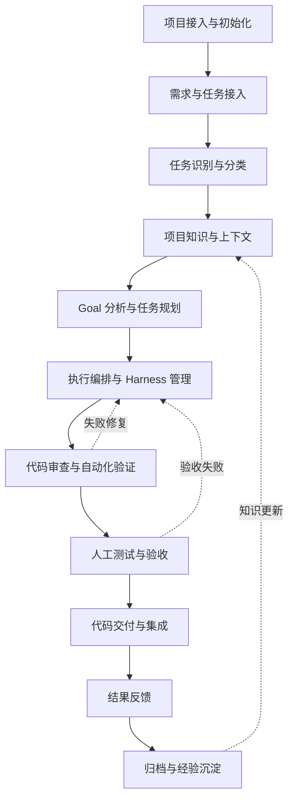

# 01 — 端到端项目流程

## 1. 流程总览

## 2. 阶段定义

### 01 项目接入与初始化

- 用户先在本地机器准备项目目录和 Git 仓库。
- 中台导入项目路径和远程仓库身份。
- Agent 扫描仓库入口文档、技术栈、依赖、启动和测试命令。
- 识别项目声明的密钥需求。
- 配置 Local Mock / Integrated 环境并进行启动验证。
- 生产凭据不参与普通初始化。

交付物：Project Profile、Repository Mapping、Environment Inventory、Secret Requirement Inventory、初始化报告。

Owner 在工作台选择“项目接入”，登记控制面机器上的 Git 仓库，随后运行 HEAD 检查。任务详情展示实际执行的 Worker、Worktree、提交号、退出码和事件。已有项目会列出最近一次 HEAD 检查。仓库尚无提交时可先检查失败回执，补上初始提交后在项目页重新检查。项目环境的启动验证和初始化报告分别验收。

成功的 HEAD 检查可在任务详情“读取仓库清单”。控制面按回执中的提交遍历已跟踪的普通文件，为入口文档、包清单、锁文件、构建与启动配置、ForgeOS 配置保存路径和 Git blob。Go 模块列出声明的依赖模块名。Node.js 包和 PHP Composer 清单分别列出包依赖及项目定义的脚本名。其他已识别的依赖清单先提供文件引用。打开历史清单可核对扫描时的 GitHub origin 和控制面绑定的仓库数字 ID。仓库更新后在项目接入页选择“检查当前 HEAD”，从新任务生成新版本的清单。

对于 `composer.json`，清单列出 `require` 和 `require-dev` 中的包及平台依赖。展开文件可查看 `composer run-script` 入口。扫描只归档名称和来源 blob，脚本内容及仓库地址配置不进入回执。[Composer 项目配置](https://getcomposer.org/doc/04-schema.md) · [Composer 脚本](https://getcomposer.org/doc/articles/scripts.md)

对于 Python，`pyproject.toml` 清单列出运行、可选、构建及依赖组中的包名，以及项目和 Poetry 声明的命令入口。包名按 PyPA 规则统一小写，把连续的点、短横线与下划线合并为短横线。动态依赖或命令字段单独标明。`requirements.txt` 支持具名直接引用、版本标记、续行和哈希选项；缺少可直接确认包名的路径、外部引用、可编辑安装及包含文件计入未解析项。扫描不运行构建后端或安装依赖。[项目元数据](https://packaging.python.org/en/latest/specifications/pyproject-toml/) · [依赖组](https://packaging.python.org/en/latest/specifications/dependency-groups/) · [pip requirements 文件](https://pip.pypa.io/en/stable/reference/requirements-file-format/)

Rust Cargo 清单列出普通、开发、构建及平台条件下声明的直接包名。重命名依赖使用实际包名。对 `workspace = true` 的条目，扫描在同一提交内查找工作区声明，记录根清单路径和 blob。虚拟工作区展示可供成员继承的共享依赖。无法从归档确认的引用计入未解析来源。此清单汇总各平台声明，具体构建选用的依赖另由 Cargo 确定。[Cargo 工作区](https://doc.rust-lang.org/cargo/reference/workspaces.html) · [Cargo 依赖声明](https://doc.rust-lang.org/cargo/reference/specifying-dependencies.html)

Maven 清单从固定提交的 `pom.xml` 读取依赖坐标。若子项目的相对路径和父项目坐标均匹配，工作台显示父 POM 的路径及 blob，并使用这条继承链上的属性。直接依赖、dependencyManagement 声明、导入的 BOM 和各 profile 的条件声明分开列出。远端父 POM、环境变量及 settings 引用计入未解析来源。扫描不下载 BOM 或运行插件，profile 的实际激活由 Maven 决定。[Maven POM](https://maven.apache.org/pom.html) · [Maven Model Builder](https://maven.apache.org/ref/3.9.11/maven-model-builder/)

Ruby 项目可分别展开 `Gemfile` 与 `Gemfile.lock`，也支持 Bundler 的 `gems.rb` 和 `gems.locked`。前者显示普通字面量 gem 声明，包括 group、platforms 和 path 块中的包名；后者只显示 DEPENDENCIES 段的直接依赖。每份来源对应本次检查的独立 Git blob。对含 Ruby 表达式、多行字符串或其他无法静态识别语句的 Gemfile，报告标记未解析；已有锁文件仍可单独查阅。gemspec 与 eval_gemfile 记为额外的未解析来源。扫描不运行项目 Ruby 代码，Management 取得包名和解析状态，私有源地址及 path 参数不会进入摘要。

Gradle 的 `*.versions.toml` 在清单中作为版本目录列出。展开文件可查看库别名、模块坐标，以及 bundle 的成员顺序；工作台和 Management 都保留各自来源的 Git blob。目录里可有尚未被构建引用的库，模块是否实际使用还要对照构建脚本。未定义的 bundle 成员会使此目录标为无效。[Gradle 版本目录](https://docs.gradle.org/8.14.3/userguide/version_catalogs.html)

展开 `build.gradle` 或 `build.gradle.kts` 可以按配置核对顶层 dependencies 块中的直接声明。常见配置及显式 add 调用支持字面量模块坐标、Groovy map 或 Kotlin 命名参数、项目引用和 platform 包装。版本目录引用按源码保留，例如 libs.core.api 或 libs.bundles.core.kit；可对照同一提交中实际使用的目录查看模块。变量、条件、其他项目作用域等无法确定的来源保留未解析计数。遇到无法可靠识别的字符串语法时，整份脚本标记为未解析。初始化过程不运行构建脚本。

Owner 用 `POST /tasks/{id}/repository-inventory` 生成或复用清单，`GET` 读取归档。首次扫描需要本机克隆仍有对应提交，归档随项目数据库保存。无效或过大的清单会在对应条目标明原因。整棵树的 Git 列表上限为 16 MiB，最多归档 2000 个匹配文件；解析单个包清单最多读取 256 KiB，每次累计 8 MiB。符号链接、子模块、vendor 和 node_modules 目录不作为初始化输入。依赖声明与脚本名称仅作发现依据，启动及测试结果另有实际执行回执。

需要声明项目密钥时，将环境、名称和预期风险写入根配置的 `secret_requirements`。扫描结果附在该文件的条目中。实际元数据登记与执行授权见[密钥需求和授权](09-security-and-secrets.md#项目声明的需求)。

在仓库清单选择“归纳入口文档”，对应项目的 Management Agent 会读取归档版本的入口文档原文和包清单摘要。工作台按项目用途、技术栈、依赖、启动及测试命令展示结果，展开一项可核对引用与来源 blob。启动及测试命令必须是所引来源内的原文；实际运行结果由对应检查记录。

归纳报告随原生会话保存实际使用的 Codex 沙箱、审批模式和禁用功能，工作台可展开“Management权限配置”核对。控制面重启后，权限配置仍与该份报告及来源 blob 关联。新旧角色通过领取响应协商回执，升级前报告保留当时已有字段。[验收记录](acceptance.md)

选择“归档当前报告”可保存这次 HEAD 检查的项目画像、仓库映射、环境与密钥需求清单，以及归档时已有的启动回执。尚未派发的归纳、未记录的声明、未执行的检查和失败结果分别显示。新证据出现后可生成下一版，使用“报告版本”切换，或将选中的版本下载为 JSON。

在同一文件的 `local_environments` 中声明本地启动脚本和 HTTP 就绪路径。在工作台展开根配置，选择环境的“启动检查”。Worker 领取该任务，按来源 HEAD 的 Git 提交运行脚本并探测 HTTP 就绪路径。任务详情保留执行节点、容器清理和探测结果。集成环境通过项目专属的 Docker 内部网络访问测试依赖。也可在执行节点单独运行 `worker verify-environment`。[启动配置和回执](local-development.md#验证项目的本地启动环境)

### 02 需求与任务接入

- GitHub Issue 是第一版主要远程入口。
- 中台 Web 是辅助入口。
- Agent 任务模板自动进入待调度流程。
- 普通讨论模板只进入讨论收件箱，不启动 Agent。
- 允许普通讨论后续转换为 Agent 任务。
- 本地 Poller 为主要同步方式，Webhook 可作为补充。
- 事件去重、需求版本、角色权限必须具备。

### 03 任务识别与分类

主要类型：
- Development；
- Code Review；
- Testing；
- Investigation；
- Operations。

分类规则优先，必要时调用分类 Agent。意图不清楚时进入澄清，不擅自扩大任务范围。

### 04 项目知识与上下文

- Agent 自主读取仓库文档和代码。
- 中台提供项目结构化信息 API 和知识检索 API。
- 不把整个仓库预先塞入模型上下文。
- 按 Agent 角色提供不同的启动提示词和工具权限。
- 检索结果必须包含来源、状态和适用范围。

### 05 Goal 分析与任务规划

- 简单任务直接 Work Item。
- 复杂任务使用 Goal → Milestone → Work Item。
- Planner 先 Discovery，再做滚动规划。
- Work Item 必须有目标、范围、依赖、验收标准和交付物。
- 形成 DAG，避免循环依赖。
- Management Agent 审核计划。
- Policy Engine 检查权限。
- 大型 Goal 的正式计划和重要变更同步 Git；运行状态留在中台。

### 06 执行编排与 Harness 管理

- Orchestrator 调度任务。
- Worker Daemon 在本地执行机器运行。
- 第一版复用已登录的 Linux 用户身份和本地 Harness 登录状态。
- 每个写入型 Work Item 使用独立 Git Worktree。
- Harness Adapter 管理 Codex、Claude Code 等 CLI。
- Session 与 Process 分离管理。
- 命令进入 Command Queue，普通变更在安全检查点处理。
- 等待人工输入时保存检查点，尽可能恢复原生 Session。

### 07 代码审查与自动化验证

- 项目仓库声明 `validation.yaml`。
- 中台结合任务类型、Git Diff、敏感模块和交付目标选择 V1-V4。
- Review Agent 使用只读环境和固定 Commit。
- Local CI Runner 执行确定性命令。
- 所有验证结果绑定 Commit SHA。
- 失败分类后交给开发 Agent、基础设施处理或人工决策。

### 08 人工测试与验收

- 全局 Acceptance Playbooks 提供通用验收方法。
- 项目仓库 `acceptance.yaml` 声明模块特殊验收要求。
- Test Agent 生成具体测试计划。
- Management Agent 检查覆盖。
- 需要人工操作时，Preview Manager 启动预览。
- 用户通过 Tailscale 私网访问。
- 浏览器反馈扩展支持元素批注、截图、录屏和问题报告。
- 验收记录绑定 Commit SHA。

### 09 代码交付与集成

- 人工验收通过后冻结验收 Commit。
- 推送任务分支。
- 自动创建 GitHub PR。
- 检查 CI、Review、冲突、权限和分支保护。
- 默认 Squash Merge。
- 目标分支由项目配置指定，默认仓库默认分支。
- 成功后记录 Merge Commit SHA。
- 不触发生产部署。

### 10 结果反馈

- 更新 Task / Goal 状态。
- 根据任务层级判断是否关闭 Issue。
- 生成交付报告。
- 更新 GitHub Issue 和中台面板。
- 对需要人工处理的事项发送通知。Owner 在工作台“通知”打开相关任务或计划修订。标为已读后仍可处理，答复或验收由对应任务入口完成。

### 11 归档与经验沉淀

- 归档需求、计划、决策、Execution、Session 关联、Commit、CI、验收、PR。
- 清理安全可清理的临时资源。
- Knowledge Curator 提取知识建议。
- Management Agent 审核。
- 正式决策、工程规则和跨项目共享遵循各自审批规则。

## 3. Issue 关闭规则

- 简单 Work Item：PR 合并成功后可关闭对应 Agent Issue。
- 复杂 Goal：所有必需 Work Item 和 Milestone 完成后才关闭父 Issue。
- 普通讨论 Issue：不自动关闭。
- 失败或取消：保留 Issue 并记录结果。
- 多个子 PR 使用引用关联父 Issue，不能由第一个子 PR 提前关闭父 Issue。

## 4. 流程验收对照

下表按本页的 11 个步骤索引已运行的场景。提交列给出 ForgeOS 的实现或验收提交；候选和合并 SHA 见各项回执。专题 16 的环境与恢复条件单列在[开放项对照](16-open-decisions.md#requirement-status)中。

| 步骤 | 已核对的操作与实际结果 | ForgeOS 提交 | 尚待验收 |
| --- | --- | --- | --- |
| 01 项目接入 | 工作台导入 Git 项目，在固定 HEAD 运行检查，生成环境、密钥需求清单和有版本的初始化报告。[六项接入要求及各自提交](acceptance.md#intake-knowledge-matrix) | `9a75d9e` | Linux 专用服务身份的模型登录见步骤 06。 |
| 02 需求接入 | 标签触发和 Owner 派发在领取时有不同来源；关闭轮询仍可在网页按编号派发，重复提交只产生一个工作项。[首次来源](acceptance.md#native-issue-dispatch-origin) · [两个浏览器的回执](acceptance.md#web-issue-number) | `b93d5ae`、`effbc78` | — |
| 03 任务分类 | 实测五类 Issue 的路由、原生分类建议与 Owner 决定。类型不清时保留讨论，Owner 明确为测试后才进入只读规划。[分类与名额](acceptance.md#issue-classification-agent) · [冲突与澄清](acceptance.md#web-issue-number) | `439415c`、`2906d5a`、`effbc78` | — |
| 04 知识与上下文 | 核对六类角色各自的原生输入或输出、项目范围、规则版本和来源，另从指定提交查询历史资料。[角色、原生会话及逐项提交](acceptance.md#knowledge-role-matrix) · [历史检索](acceptance.md#history-hybrid-search) | `7859f9d`、`3744ecc` | — |
| 05 Goal 规划 | Planner 从普通讨论生成草案；生效计划的相依子项按序交付，Owner 回答问题并退回一次后才关闭父 Goal。[原生草案](acceptance.md#native-issue-dispatch-origin) · [两次子 PR](acceptance.md#dependent-goal-275) | `b93d5ae`、`73339a5` | — |
| 06 编排与 Harness | 独立 Worker 在工作树生成候选；控制面与 Worker 中断后按原执行补报，独立角色在 Daemon 替换后继续运行。[补报和串行派发](acceptance.md#foundation-before-report) · [角色恢复](acceptance.md#supervised-roles) | `3296a47`、`ffb9103` | Linux 服务账号登录和共享名额、整机重启、Claude 恢复后成功交付。 |
| 07 审查与自动验证 | 在固定候选执行容器检查，失败及通过日志均可从网页下载。独立 Reviewer 的固定候选与真实失败进程均有回执。[验证分级](acceptance.md#check-b-6) · [Go 检查](acceptance.md#builtin-go-archive) · [Reviewer](acceptance.md#reviewer-central-log) | `35866ba`、`9431507`、`b064477` | 当前环境的 Claude Reviewer 接回后成功审查。 |
| 08 人工验收 | 项目标准与全局 Playbook 生成逐条测试计划，覆盖审核、扩展截图和录屏绑定到候选，Owner 可据此退回。[测试计划](acceptance.md#check-b-7) · [浏览器扩展](acceptance.md#check-a-8) | `978d184`、`5279f11`、`5a5d685` | 第二台设备经 Tailscale 访问、独立 Staging 的外部提供方回调。 |
| 09 代码交付 | 网页批准固定候选，必需检查首轮失败、重跑通过后合入受保护的 main。重启控制面后候选和合并 SHA 与 GitHub 一致。[beta #273](acceptance.md#single-project-273) · [beta #278](acceptance.md#web-issue-number) | `7f461fa`、`f8c32e3` | GitHub 受限身份及第二位审查者批准。 |
| 10 结果反馈 | 子项交付后父 Issue 继续开放，最后一项完成才关闭；单项目可回查 PR、Actions 与 Issue。任务需人工处理时可从站内通知进入。[父子交付](acceptance.md#dependent-goal-275) · [通知及真实收件条件](03-module-catalog.md#外部通知) | `73339a5`、`31a46df` | Telegram 与飞书的真实收件。 |
| 11 归档与经验 | 从备份恢复中央进程日志、待传 CI 文件和反馈媒体。需求、计划、决策、合并及共享经验按来源回查。[进程](acceptance.md#central-process-backup) · [CI](acceptance.md#ci-backup-pending) · [媒体](acceptance.md#feedback-backup-restore) · [知识提取触发](acceptance.md#intake-knowledge-matrix) | `755c6c0`、`0f76287`、`a2ace7d`、`52fe76e` | 全路线联验时复核两个项目的归档与隔离。 |
