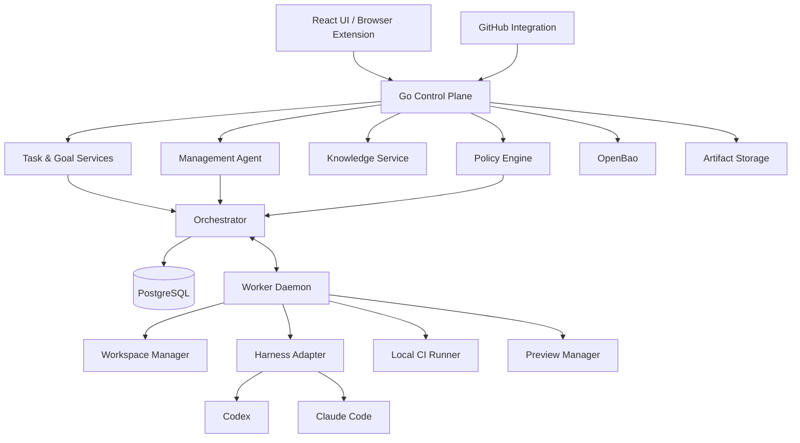

# 02 — 系统总体架构

## 1. 架构风格

建议采用：

**模块化单体控制面 + 独立 Worker Daemon + Harness Adapter + 本地基础设施。**

第一版不采用微服务、Kubernetes 或复杂分布式工作流平台。

控制面和 Worker Daemon 可以部署在同一台机器，但必须是独立进程，具有独立生命周期。

## 2. 六层逻辑架构

1. 用户交互层：React 管理后台、远程预览、浏览器反馈扩展。
2. 业务控制层：项目、Issue、任务、Goal、知识、决策、验收管理。
3. 执行编排层：Orchestrator、队列、状态机、Policy Engine。
4. 本地执行层：Worker Daemon、Harness Adapter、Worktree、CI、Preview。
5. 数据与知识层：PostgreSQL、pgvector、OpenBao、Git、文件存储。
6. 基础设施层：Tailscale、Caddy、systemd、GitHub API、备份和监控。

## 3. 控制面与执行面

### Control Plane

职责：
- 对外提供 API；
- 接收 GitHub 事件；
- 管理任务和计划；
- 调用 Management Agent；
- 运行 Orchestrator；
- 管理策略和审计；
- 分配 Worker 任务。

### Worker Runtime

职责：
- 注册 Worker；
- 接收带租约的执行任务；
- 创建/恢复 Worktree；
- 启动和管理 Harness；
- 采集事件；
- 管理进程；
- 执行本地 CI 和预览服务；
- 断线缓存并补传事件。

## 4. 主要组件关系

## 5. 组件通信

- UI 到 Control Plane：HTTPS REST，实时状态使用 WebSocket。
- GitHub 到 Control Plane：Poller 为主，Webhook 可选。
- Control Plane 到 Worker：建议 Worker 主动建立 mTLS gRPC 双向流。
- Worker 到 Harness：本机 stdio / 原生协议 / CLI 结构化输入输出。
- Agent 到中台工具：通过受控 API 或 MCP 工具接口。
- CI Runner：由 Worker/Control Plane 创建受控 Run。

## 6. 关键架构约束

- Agent 不直接修改中台正式任务状态。
- Agent 通过消息、请求和结果事件与中台交互。
- Orchestrator 是执行状态的权威管理者。
- Policy Engine 是权限决策的强制执行点。
- Management Agent 不持有任意生产权限。
- Worker 不需要公网入站端口。
- 生产部署不属于系统流程。
- 本地执行环境不默认使用容器；高风险或不可信任务可升级隔离。
