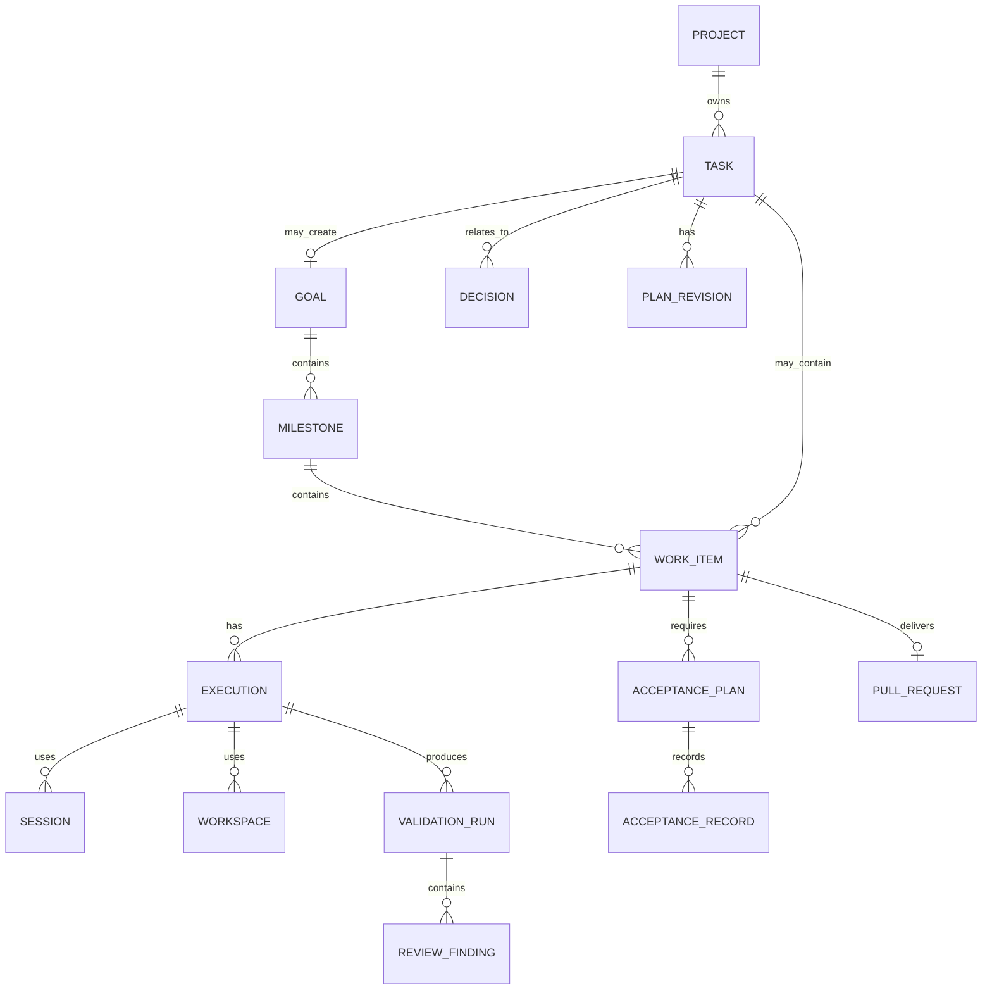

# 04 — 核心领域模型

## 1. 主要对象

| 对象 | 含义 |
|---|---|
| Project | 已导入中台的内部项目 |
| Task Request | 用户原始需求入口 |
| Issue Link | 外部 GitHub Issue 与中台对象的关联 |
| Goal | 复杂任务的最终目标 |
| Milestone | Goal 下的阶段性交付 |
| Work Item | 独立、可执行、可验收的工作 |
| Plan Revision | 某一版本的规划快照 |
| Execution | 一次实际执行尝试 |
| Session | Harness 原生持续会话 |
| Process Instance | 一次启动的操作系统进程。Claude 实现、Codex 实现与只读规划的执行回执记录节点内实例号、PID、版本、原生 Session、起止时间及退出码，由 Execution 关联其节点和工作区。运行时可核对最近一次节点进程观察及控制面的接收时间 |
| Workspace | 一个 Execution 使用的工作目录/Worktree |
| Decision | 管理 Agent 或人工形成的决策 |
| Approval Request | 对具体操作或计划的审批请求 |
| Validation Run | 针对固定 Commit 的验证执行 |
| Acceptance Plan | 人工验收计划 |
| Acceptance Record | 人工测试结果和证据 |
| Pull Request | GitHub PR |
| Artifact | 日志、截图、录屏、报告等文件 |

## 2. 动态层级

简单任务：
`Task Request → Work Item → Execution`

复杂任务：
`Task Request → Goal → Milestone → Work Item → Execution`

任务执行失败或需要重新执行时，通常创建新的 Execution，不重复创建 Work Item。

## 3. 关键关联

## 4. 状态模型建议

### Goal
`ACTIVE / PAUSED / BLOCKED / COMPLETED / CANCELED`

### Work Item
`BLOCKED / READY / RUNNING / WAITING_INPUT / WAITING_APPROVAL / VERIFYING / WAITING_ACCEPTANCE / DONE / FAILED / CANCELED`

### Execution
`CREATED / STARTING / RUNNING / SUSPENDED / WAITING / COMPLETED / FAILED / CANCELED`

### Session
`CREATED / ACTIVE / WAITING / RESUMABLE / INTERRUPTED / COMPLETED / FAILED`

### Process
`STARTING / RUNNING / EXITED / TERMINATED / CRASHED`

不要把 Execution、Session、Process 状态合并成一个字段。

## 5. 版本与追溯

每个任务执行至少关联：
- Task ID；
- Requirement Revision；
- Plan Revision；
- Project Base Commit；
- Execution ID；
- Harness Session ID；
- Workspace Branch；
- Candidate Commit SHA；
- Validation Run ID；
- Acceptance Record ID；
- PR ID；
- Merge Commit SHA。

工作台“验收记录”使用 `acceptance_reviews.execution_id` 作为记录编号，每次执行最多有一条决定。批准或退回事件的下载回执以 `payload.acceptance_id` 指向该记录。返工产生新的执行和验收记录。[两次验收与十二项关联的实测](acceptance.md#candidate-record-identity)

## 6. 幂等与一致性

- GitHub Event ID 有唯一约束。
- Command ID 有幂等键。
- Execution 派发使用 Lease。
- PR 创建使用任务/分支幂等标识。
- 合并操作必须记录目标分支和最终 SHA。
- 状态变更采用受控事务和事件记录。
