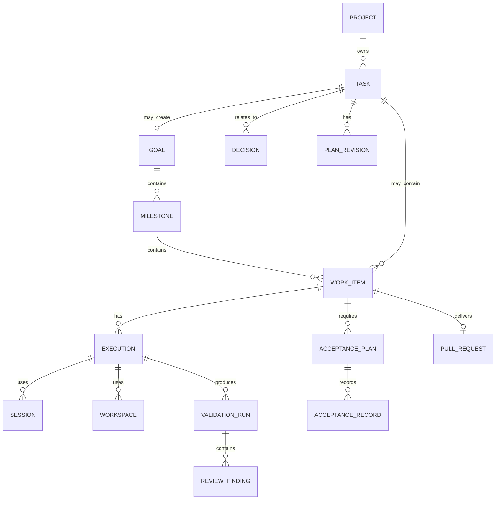

# 04 — 核心领域模型

## 1. 主要对象

| 对象 | 含义 | 实际使用入口与提交 |
|---|---|---|
| Project | 已导入中台的内部项目 | [登记并检查本地仓库](acceptance.md#intake-project-path) · `d57f60d` |
| Task Request | 用户原始需求入口 | [接收 Issue 并保留原始版本](acceptance.md#issue-import-audit) · `9aeaa8f` |
| Issue Link | 外部 GitHub Issue 与中台对象的关联 | [按编号派发及重复派发](acceptance.md#web-issue-number) · `effbc78` |
| Goal | 复杂任务的最终目标 | [父 Issue 等全部必需项交付后关闭](acceptance.md#dependent-goal-275) · `73339a5` |
| Milestone | Goal 下的阶段性交付 | [按已归档的里程碑与依赖激活两项工作](acceptance.md#dependent-goal-275) · `73339a5` |
| Work Item | 独立、可执行、可验收的工作 | [子项完成前后分别核对任务与依赖](acceptance.md#dependency-release-audit) · `c3ac432` |
| Plan Revision | 某一版本的规划快照 | [升级后从原生 Planner 事件找到初版](acceptance.md#legacy-planner-event) · `13ccb3b` |
| Execution | 一次实际执行尝试 | [重试后分别定位原失败与后继执行](acceptance.md#workbench-failed-execution-retry) · `6b56a2c` |
| Session | Harness 原生持续会话 | [暂停、恢复与原会话关联](acceptance.md#model-pause-audit) · `562b666` |
| Process Instance | 一次启动的操作系统进程。Claude 实现、Codex 实现与只读规划的执行回执记录节点内实例号、PID、版本、原生 Session、起止时间及退出码，由 Execution 关联其节点和工作区。运行时可核对最近一次节点进程观察及控制面的接收时间 | [从节点与工作台核对 PID、Thread、Turn](acceptance.md#worker-app-turn) · `1f31794` |
| Workspace | 一个 Execution 使用的工作目录/Worktree | [整机重启后验证原工作树和结果](acceptance.md#linux-power-loss-worktree) · `f0cd68f` |
| Decision | 管理 Agent 或人工形成的决策 | [项目决定的 D1 引用与 D2 问题审核](acceptance.md#question-advice-event-audit) · `92127c3` |
| Approval Request | 对具体操作或计划的审批请求 | [从审批中心逐项回复 D2、D3 问题](acceptance.md#approval-questions) · `d329bba` |
| Validation Run | 针对固定 Commit 的验证执行 | [同一任务两次候选各有独立运行号](acceptance.md#candidate-record-identity) · `683d14f` |
| Acceptance Plan | 人工验收计划 | [生成具体用例，经独立覆盖审核并实际执行](acceptance.md#candidate-approval-basis) · `83640fa` |
| Acceptance Record | 人工测试结果和证据 | [从退回、批准两条记录追溯各自候选](acceptance.md#candidate-record-identity) · `683d14f` |
| Pull Request | GitHub PR | [固定候选的 PR、远端检查与合并 SHA](acceptance.md#single-project-273) · `7f461fa` |
| Artifact | 日志、截图、录屏、报告等文件 | [中央与节点的日志、报告逐文件恢复校验](acceptance.md#ci-backup-pending) · `0f76287` |

## 2. 动态层级

简单任务：
`Task Request → Work Item → Execution`

复杂任务：
`Task Request → Goal → Milestone → Work Item → Execution`

任务执行失败或需要重新执行时，通常创建新的 Execution，不重复创建 Work Item。

## 3. 关键关联

## 4. 状态模型建议

### Goal
`ACTIVE / PAUSED / BLOCKED / COMPLETED / CANCELED`

### Work Item
`BLOCKED / READY / RUNNING / WAITING_INPUT / WAITING_APPROVAL / VERIFYING / WAITING_ACCEPTANCE / DONE / FAILED / CANCELED`

### Execution
`CREATED / STARTING / RUNNING / SUSPENDED / WAITING / COMPLETED / FAILED / CANCELED`

### Session
`CREATED / ACTIVE / WAITING / RESUMABLE / INTERRUPTED / COMPLETED / FAILED`

### Process
`STARTING / RUNNING / EXITED / TERMINATED / CRASHED`

不要把 Execution、Session、Process 状态合并成一个字段。

## 5. 版本与追溯

每个任务执行至少关联：
- Task ID；
- Requirement Revision；
- Plan Revision；
- Project Base Commit；
- Execution ID；
- Harness Session ID；
- Workspace Branch；
- Candidate Commit SHA；
- Validation Run ID；
- Acceptance Record ID；
- PR ID；
- Merge Commit SHA。

工作台“验收记录”使用 `acceptance_reviews.execution_id` 作为记录编号，每次执行最多有一条决定。批准或退回事件的下载回执以 `payload.acceptance_id` 指向该记录。返工产生新的执行和验收记录。[两次验收与十二项关联的实测](acceptance.md#candidate-record-identity)

## 6. 幂等与一致性

| 要求 | 已验证的操作与结果 | ForgeOS 提交 |
| --- | --- | --- |
| GitHub Event ID 有唯一约束 | [重投原件、重启再投，复用同一条归档](acceptance.md#github-webhook-replay) | `4ea0363` |
| Command ID 有幂等键 | [控制面重启后重放 Owner 原指令，相同键修改正文被拒](acceptance.md#check-b-3) | `ae0a57a` |
| Execution 派发使用 Lease | [首项回报前中断，另一节点领取被拒，原执行补报完成](acceptance.md#foundation-before-report) | `863f0da` |
| PR 创建使用任务与分支的幂等标识 | [创建 PR 的响应丢失后重启，交付仍使用同一个 PR](acceptance.md#check-b-8) | `32c0fa0` |
| 合并操作记录目标分支和最终 SHA | [核对 PR #277 的任务分支、main 与合并提交](acceptance.md#candidate-record-identity) | `683d14f` |
| 状态变更采用受控事务并记录事件 | [批准被阻止、成功与重放，原决定和事件一致](acceptance.md#candidate-approval-basis) | `83640fa` |
